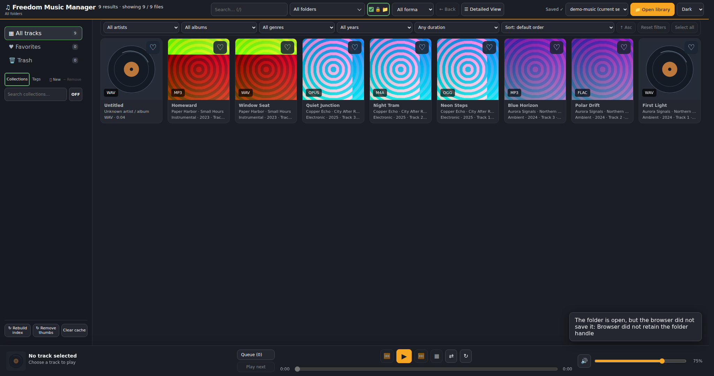
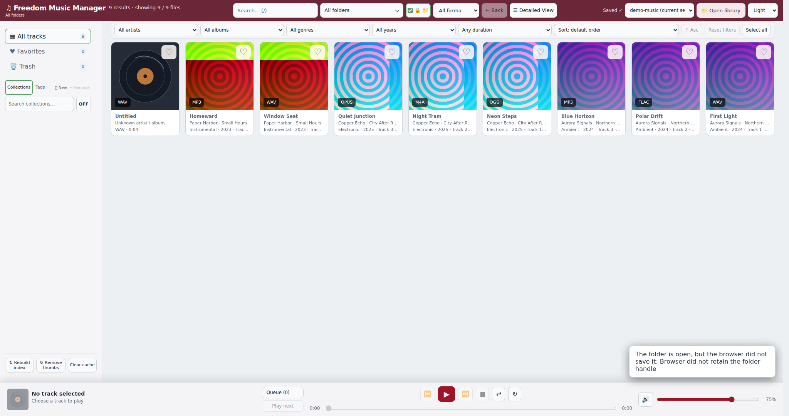
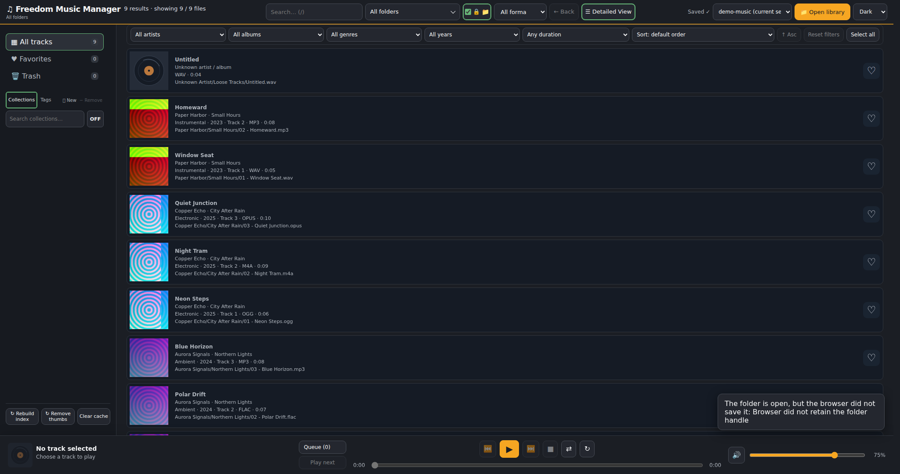
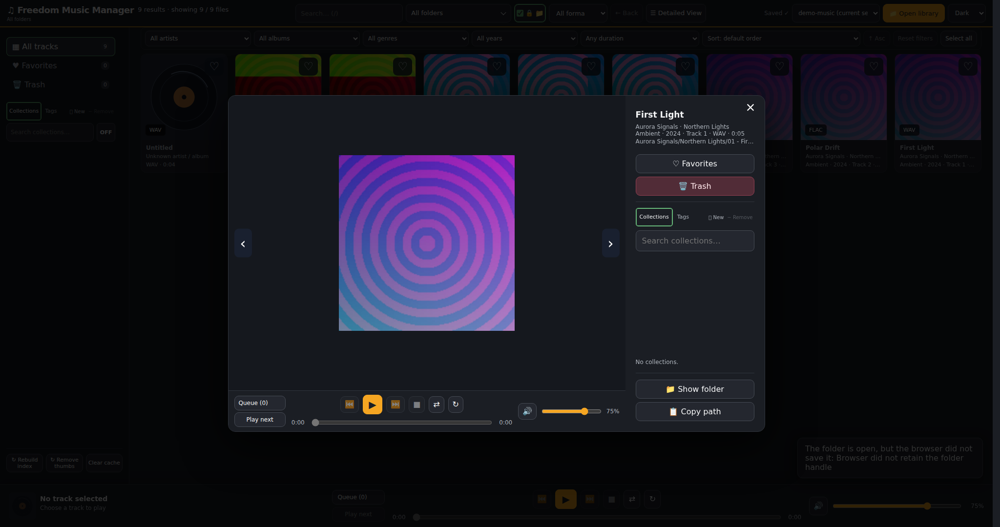
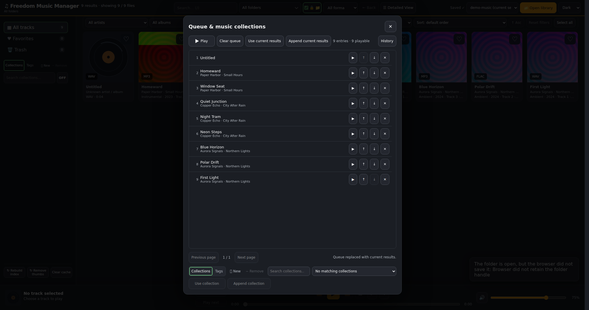
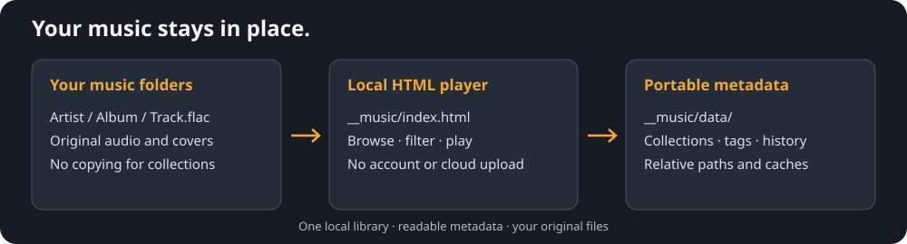

<div align="center">

# Freedom Music Manager

**Version 1.0.0 — release candidate**

**Your music. Your folders. Your freedom.**

A portable, private music library and player that runs directly from one local HTML file.
Browse your collection, discover forgotten tracks, build playlists and keep your original audio files where they belong.

[**Download a clean ZIP**](https://github.com/nibage/freedom-music-manager/actions/workflows/build.yml) · [Tagged releases](https://github.com/nibage/freedom-music-manager/releases) · [Try the demo](#try-the-demo) · [User guide](#user-guide) · [Technical documentation](#technical-documentation)

</div>

## Made for the music library you already have

| 📁 No lock-in | 📴 Works offline | 🎵 Your listening flow | 🏷️ Organize your way |
| :-- | :-- | :-- | :-- |
| Keep your existing artist and album folders. | No account, cloud upload or runtime server. | Persistent player, queue, playlists, shuffle, repeat and listening history. | Ordered collections, custom tags, favorites, metadata filters, light/dark themes. |

### Screenshots

Actual application captures are generated in Chromium at 2048 × 1080 (desktop) and 390 × 844 (mobile), using the original nine-track synthetic demo. No personal music or artwork is used. The [screenshot workflow](https://github.com/nibage/freedom-music-manager/actions/workflows/readme-screenshots.yml) refreshes these images after successful capture.

| Classic · dark | Classic · light | Detailed · dark |
| :--: | :--: | :--: |
|  |  |  |
| Browse album covers. | A bright alternative. | Inspect track metadata at a glance. |

| Track preview | Queue and collections |
| :--: | :--: |
|  |  |
| View metadata and manage membership while listening. | Assemble a listening session from your results, collections or tags. |

[Mobile layout preview](docs/screenshots/mobile-light.png) · Desktop Chrome and Edge remain the recommended environment for writable folder access.

### See how it works



**1. Open a folder.** Select the root of your music collection. The app builds a reusable local index and reads supported embedded audio metadata and artwork.

**2. Find what matters.** Search filenames and paths, browse folders, filter by artist, album, genre, year, duration or format, and combine custom collections and tags.

**3. Listen your way.** Select tracks, play them once or replace the queue, append more music, reorder upcoming tracks, or return to your listening history.

**4. Curate without copying.** Make ordered collections, add tags and favorites, and keep your library portable. Original audio tags are read, not rewritten.

### Try the demo

The separately packaged **demo ZIP** is configured to contain **2,009 original synthetic tracks**: nine varied examples across WAV, MP3, FLAC, Ogg Vorbis, M4A and Opus, plus 2,000 short tagged WAVs for stress testing. It includes generated album covers and known metadata, with no commercial recordings.

Extract the demo ZIP, open `__music/index.html` in desktop Chrome or Edge, click **Open library**, and choose the included `demo-music` folder. Try Classic/Detailed views, filtering, queue management and loading many tracks without using your personal library.

For development from a Git clone, generate the demo locally (see [Development](#development)). The media files are not tracked in Git.

---

# User guide

## Install and reopen your library

Download a clean application ZIP from a **successful** [GitHub Actions build](https://github.com/nibage/freedom-music-manager/actions/workflows/build.yml) or a published [release](https://github.com/nibage/freedom-music-manager/releases). Extract the `__music/` folder into your music root:

```text
Music/
├── Artist/
│   └── Album/
│       ├── 01 - Track.flac
│       └── cover.png
└── __music/
    └── index.html
```

Open `Music/__music/index.html` in **Google Chrome or Microsoft Edge**. Choose **Open library** and select `Music`, not `__music`. Grant read/write permission. The initial scan creates local metadata in `__music/data/`; subsequent visits can reuse the saved index and cached metadata.

**Reopening:** the browser stores recent native directory handles. The application opens the last library automatically when permission is available; otherwise choose a remembered library in the selector or use Open library again. If the browser offers **Allow on every visit**, you can choose it for trusted folders. Local `file://` permissions may be shared or grouped by the browser and may require renewed approval; the app cannot bypass that prompt. Use the same HTML location, browser and profile for the best chance of restoration.

Each remembered library has its own saved view: folder, search, format, collections/tags, Favorites/Trash, OFF/OR/AND, folder lock, metadata filters, sort and sidebar search/mode. Scroll position, transient track selection and live playback are not restored.

**Updating:** back up `__music/data/` and replace only `__music/index.html`. Keep your audio and metadata. No runtime Node.js, Python or FFmpeg installation is required to use the HTML app.

**Browser support:** desktop Chromium browsers with the File System Access API are recommended; Firefox does not provide the required persistent writable-folder access. Codec support depends on the browser and operating system.

## Browse and filter

| Control | Behavior |
| :-- | :-- |
| Search | Search tracks; a non-empty search in an unlocked folder searches the whole library. |
| All folders / Lock folder | Browse a folder and its descendants. When locked, all filters remain inside that folder. |
| Folder selector | Displays the last folder name when closed, full relative paths in its menu; the header shows the selected relative path. |
| All formats | Narrow to a supported audio extension. |
| Detailed View | Toggle between cover cards and a metadata-rich list; green indicates Detailed View is active. |
| Artist / Album / Genre / Year / Duration | Filter using embedded audio metadata; available values and counts follow the current scope. |
| Sort | Choose order and direction; default order respects a single saved collection. |
| Reset filters | Clear metadata facets, search, format and folder, while preserving sidebar criteria and sort. |
| Select all | Select all filtered results, including those not yet rendered. |
| ← Back | Clear a track selection first, then restore previous filter views (up to 50 steps per library session). Not a metadata undo. |
| Theme selector | System, Light or Dark. |

### Combine collections, tags and favorites

**Album** means an embedded audio metadata field. A **Collection** is an ordered, editable virtual playlist that can contain tracks from any folder or album. Tags are reusable labels, not ordered playlists.

| Operator | Example | Result |
| :-- | :-- | :-- |
| OFF | Collection A | One sidebar criterion at a time. |
| OR | Collection A + Tag Rock | Tracks in either group. |
| AND | Collection A + Tag Rock + Favorites | Tracks satisfying every selected condition. |
| All | Clear sidebar criteria | Restore ordinary browsing; clears the folder if unlocked, keeps it if locked. |

OFF/OR/AND applies only to collections, custom tags, Favorites and Trash. Search, format, metadata facets and a locked folder always narrow the result using AND. When unlocked, a non-empty search or sidebar criterion is global; ordinary folder browsing still respects the chosen folder. Trash is excluded unless explicitly selected.

## Select and play music

Click a track title to select it without interrupting existing playback. Click the same sole selected title again to deselect. Click cover artwork (including the bottom player's cover) to open the track preview. It shares the same audio player, transport controls, volume and seek position. The background page does not scroll while a modal is open.

| Action | Result |
| :-- | :-- |
| Click title | Select one track and prepare it in the bottom player. |
| Ctrl/Cmd-click | Add/remove a track from selection. |
| Shift-click | Select a range. |
| Play | Start the selected tracks in current results order. With no selection in preview, play the open track. |
| Play once | If another queue exists, play the new selection as a finite sequence without replacing the original queue. |
| Replace queue | Replace the old queue with selected tracks; repeat resets to Off. |
| Queue hover + / − | Add missing selected tracks or remove selected queued tracks without stopping current audio. |
| Play next | Insert selected playable tracks after the current track. |
| Back / Escape | Dismiss selection and return to the actual playing track. |

The Play once / Replace queue dialog appears when a different nonempty queue exists. Close it or press Escape to cancel. Once the finite selection finishes, playback stops; Play once preserves the original queue. Missing files and Trash are not playable.

The transport supports previous/next, play/pause, stop, shuffle, repeat off/one/all, seeking, mute and volume. Explicit queue edits are deduplicated.

## Queue, history and collections

Click **Queue** in the bottom player or preview. Queue and History share a stable dialog size, and History expands its list by hiding collection controls.

| Queue control | Behavior |
| :-- | :-- |
| Play / Pause | Play the queue, resume its paused track or pause active audio. |
| Clear queue | Stop playback, empty the queue and clear main-library selection. |
| Use current results | Replace the queue with playable tracks in the current filtered results. |
| Append current results | Append matching playable tracks without duplicates. |
| Remove from queue (N) | Remove selected entries without deleting originals or interrupting current audio. |
| Collections / Tags | Choose the type, search by name, and select a matching group. |
| + New / − Remove | Create a group from the queue or remove a group after confirmation. |
| Use collection / tag | Replace queue with playable members. |
| Append collection / tag | Append playable members without duplicates. |

Queue and History support independent click, Ctrl/Cmd-click, Shift-click, drag-range, Ctrl/Cmd-drag and Ctrl/Cmd+A selection across pages. Dragging can start in empty list space; a blank click clears the selection. Row action buttons remain independent.

**History** records up to 200 playback starts locally. Play uses selected history tracks, or the whole history if nothing is selected, without replacing the persistent session queue. Repeated paths are deduplicated in displayed order. **Use selection as queue** replaces the queue, **Append selection to queue** adds the selected history tracks, and **Clear history** clears the listening log after confirmation.

Collections preserve membership order; newly added tracks append. Tags do not store playback order. Create a collection or tag from the sidebar to assign the current selection automatically (or create an empty group when nothing is selected). Creating one in the preview assigns the open track. Use the green membership + / − actions to add/remove assignments without copying media.

## Keyboard shortcuts

| Shortcut | Action |
| :-- | :-- |
| Space | Play/pause in the main view or track preview, when not editing or using a conflicting dialog. |
| Ctrl/Cmd+A | Select all in Queue or History. |
| Ctrl/Cmd+Z | Undo the last supported metadata edit (one step per session). |
| Escape | Close preview or clear selection. |
| / | Focus search. |

## Maintenance and deletion safety

| Control | Behavior |
| :-- | :-- |
| Rebuild index | Rescan audio files after additions, moves or renames. |
| Remove thumbs | Recreate derived cover previews if stale. |
| Clear cache | Confirm a reset of this copy's browser storage and reload. Clears saved handles, views, theme, sorting and volume; does not delete disk metadata, audio or listening history. Browser-managed permissions may remain. Close other app tabs first. |
| Remove library | Forget a remembered library, including its saved view. Does not delete audio. |

**In-app Trash** is reversible. Permanent deletion actually removes original files from disk, bypassing the operating-system Recycle Bin/Trash, and cannot be undone. There is no automatic backup. Rebuild index may clean stale references after a successful scan; make sure the correct library and all expected disks are available.

---

# Technical documentation

## Formats and metadata

MP3, FLAC, WAV, Ogg Vorbis/Opus and M4A/ALAC containers have built-in metadata readers. AAC, AIFF/AIF, WMA and raw ALAC extensions are indexed but tag parsing is not implemented for every variant. Filename recognition does not guarantee playback: native browser codec support determines decoding. Unusual tags, damaged files and CBR MP3 without duration headers may have incomplete metadata.

## Files and portable storage

```text
__music/
├── index.html
└── data/
    ├── files.txt              # relative-path inventory
    ├── collections/          # ordered paths, one file per collection
    ├── favorites.txt
    ├── tags.tsv
    ├── tag-catalog.txt
    ├── trash.txt
    ├── music-history.json    # recent playback starts
    ├── music-metadata.json   # derived embedded-tag/duration cache
    ├── media-info.tsv        # file signatures
    ├── thumbs.tsv
    ├── thumbs/               # derived cover previews
    ├── path-config.json      # optional absolute-path configuration
    └── music-layout-v1.json  # migration marker, when applicable
```

Original media remains in its directories. Library metadata and derived caches are stored alongside it, using relative paths. Recent folder permissions and per-library view preferences are browser-local, while live queue and playback position are session-local.

**Migration from Freedom Gallery:** the app can copy recognized older `__gallery/data/` or `_gallery/data/` metadata into the music layout after confirmation, including virtual albums as collections. Conflicting destination files are not overwritten. Keep the old source as a backup and do not edit the same library with both applications after migration. See [the technical reference](docs/REFERENCE.md).

## GitHub builds and release ZIPs

[Build downloadable ZIPs](https://github.com/nibage/freedom-music-manager/actions/workflows/build.yml) · [Screenshot captures](https://github.com/nibage/freedom-music-manager/actions/workflows/readme-screenshots.yml)

Successful builds produce two explicit-allowlist archives and a SHA256 checksum manifest:

- **freedom-music-manager-*.zip** — clean HTML application, README, license and documentation.
- **freedom-music-manager-demo-*.zip** — the application plus the generated synthetic library.

Current captures are included in ZIPs when screenshot capture succeeds. No development scripts, Node dependencies or personal media are packaged. A reviewed `v*` tag publishes direct release assets after successful verification. The project is still a release candidate; consult the actual workflow status before using a build.

## Development

```sh
python3 scripts/generate_music_demo.py demo-music
node --test tests/music-*.test.mjs tests/unified-music-collections.test.mjs
npm install --no-save --no-package-lock playwright@1.56.1
npx playwright install chromium
node scripts/capture-screenshots.mjs
# Capture documentation screenshots without running the long integration scenario:
node scripts/capture-screenshots.mjs --readme-only
# Expand the existing nine-track demo, then rebuild the library index if already opened:
python3 scripts/generate_music_demo.py demo-music --extend --count 2009
python3 scripts/build_music_release.py v1.0.0-rc.3
```

FFmpeg is required to generate all six demo formats; the generator otherwise falls back to WAV. Browser automation uses real synthetic audio bytes and mock filesystem handles. Native folder permission, migration and real disk persistence still require manual validation. Keep the nine-track demo for integration tests; extend it only after those tests.

## Privacy and license

Your indexed files and original music remain on your computer. The app does not upload them. Browser read/write permission is required to maintain the local metadata and to perform explicit file operations.

Derived from [Freedom Gallery](https://github.com/nibage/freedom_gallery). Licensed under GNU GPL v3; see [LICENSE](LICENSE). For internal storage and release details, see [Technical reference](docs/REFERENCE.md).
